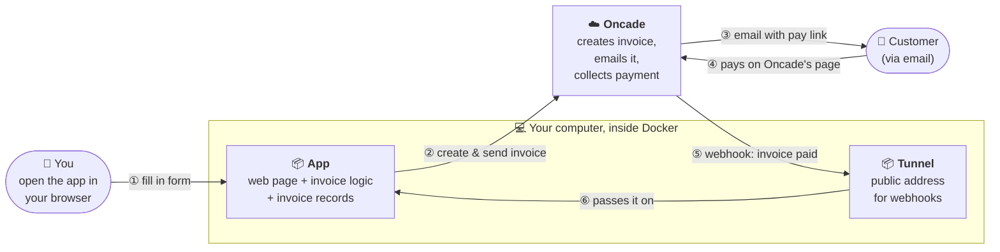
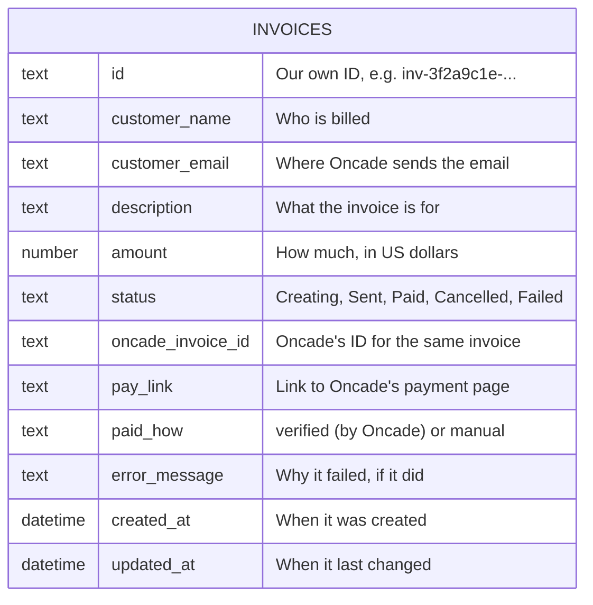

# Oncade Invoice POC

A small TypeScript app that **creates and sends invoices** through the **Oncade Platform API** (test environment), shows their **live status**, lets you **cancel** them, and updates status automatically from **Oncade's webhooks**.

**Contents**
- [Part 1: About the project](#part-1-about-the-project)
- [Part 2: Build, run and test it](#part-2-build-run-and-test-it)
- [Part 3: How AI was used](#part-3-how-ai-was-used)

---

# Part 1: About the project

## Summary

This is a proof of concept (POC) that uses Oncade Pay the way a real customer would. The goal is to show what works, what's broken and what's confusing.

**The app does three things:**
1. **Create an invoice.** Fill in a simple form (who to bill, what for, how much). The app asks Oncade to create the invoice and **send it right away**, and Oncade emails the customer a pay link.
2. **Show a list of invoices** with their current status (*Sent*, *Paid*, *Cancelled*). When the customer pays, Oncade notifies the app with a webhook and the status changes to **Paid** by itself.
3. **Cancel an invoice.** A **Cancel** button next to each unpaid invoice asks Oncade to void it, so the customer can no longer pay it.

**Where it runs:** inside **Docker**. Nothing besides Docker needs to be installed.

## Scope

| ✅ In scope                                             | ❌ Out of scope                                  |
| ------------------------------------------------------ | ----------------------------------------------- |
| A web page with a form to **create & send** an invoice | Saving invoices as drafts before sending        |
| A **list** of all invoices with live status            | An "edit invoice" screen in the app             |
| A **Cancel** button for unpaid invoices                | Re-sending invoices from the app                |
| Receiving Oncade's **webhooks** and updating status    | Payment screens (Oncade hosts the payment page) |
| Running everything in **Docker**                       | Logins or user accounts                         |

## How it works: the big picture



1. **You fill in the form** on the app's page: customer name, email, description and amount.
2. **The app asks Oncade to create the invoice and send it** in a single request.
3. **Oncade emails the customer** a link to its payment page.
4. **The customer pays** on Oncade's page, for test env Manual trigger of payment is done.
5. **Oncade sends a webhook** ("this invoice is now paid") to the tunnel's public address.
6. **The tunnel forwards it** to the app, which checks that it's genuine and marks the invoice **Paid**.

The same webhook path also handles **cancellations**, whether the invoice was cancelled in the app or in Oncade's own dashboard.


## What the app stores

The app keeps **one table** of invoices, where each row is one invoice.



## APIs used

Base URL: `https://www.oncade.gg/api/v1/platform`. 

| What | Endpoint | Scope | Used by |
|---|---|---|---|
| **Connection check** | `GET /me` | `platform:read` | Setup script (`npm run check-connection`) |
| **Create & send invoice** | `POST /invoices` with `status: "sent"` | `invoice:create` (+ `invoice:send`) | App: every **Create & Send** |
| **Cancel invoice** | `POST /invoices/{id}/cancel` | `invoice:cancel` | App: the **Cancel** button |
| **Webhooks** (Oncade → app) | received at `POST /webhooks/oncade` | — | App |

## Tools Used

| Tool                        | What it is                                | Why it was chosen                                                           |
| --------------------------- | ----------------------------------------- | --------------------------------------------------------------------------- |
| **TypeScript** (strict)     | JavaScript with type checks               | Required by the exercise                                                    |
| **Node.js 24**              | Runs the app                              | Current LTS, with a built-in SQLite driver                                  |
| **Express 5**               | Web server toolkit                        | Simple and well known                                                       |
| **tsx**                     | Runs TypeScript directly, reloads on save | No build step                                                               |
| **SQLite** (`node:sqlite`)  | Single-file database                      | No separate database server needed                                          |
| **cloudflared**             | Cloudflare quick tunnel                   | Public webhook address for a laptop, no account needed                      |
| **Docker + Docker Compose** | Runs everything in containers             | Nothing installed on the host; same setup on any machine                    |
| **Claude Code**             | AI coding assistant in the terminal       | Used to design and build the project. See [Part 3](#part-3-how-ai-was-used) |

---

# Part 2: Build, run and test it

This section takes you from zero to a working app with webhooks.
## What you need

- **Docker Desktop**, installed and **running**. 
- Nothing else gets installed; Node.js and all libraries run inside the containers.
- An **Oncade account** with access to:
  - the developer portal: **https://dev.oncade.xyz**
  - the Oncade Pay business dashboard: **https://pay.oncade.xyz**

## Step 1: Get the code

```bash
git clone https://github.com/gnmathew/oncade_invoice_poc.git
cd oncade_invoice_poc
ls
```
✅ You should see `Dockerfile`, `compose.yaml`, `.env.example`, and a `src/` folder.

## Step 2: Create a test platform in Oncade

1. Open **https://dev.oncade.xyz** and sign in

## Step 3: Create an API key

	follow the steps from the document

## Step 4: Generate the webhook secret

1. In the developer portal → your platform → **Settings** tab.
2. Click **Generate webhook secret** and copy.

> [!NOTE]
> If the portal requires a Webhook URL before it lets you generate a secret, do Steps 7–8 first, then come back here. After filling in the secret in `.env`, reload it with `docker compose up -d app`.

## Step 5: Create the settings file (`.env`)

```bash
cp .env.example .env
```

Open `.env` in any editor (`open -e .env` on a Mac) and fill in the three values:

```bash
ONCADE_API_KEY=oncade_platform_test_xxxxxxxxxxxx
ONCADE_BUSINESS_ID=xxxxxxxxxxxxxxxxxxxxxxxx
ONCADE_WEBHOOK_SECRET=xxxxxxxxxxxxxxxxxxxxxxxx
```

- At startup, the app checks that all three are filled in and that the key is a **test** key. If anything is wrong, it stops and prints which setting is the problem.

## Step 6: Build and start the containers

```bash
docker compose up -d --build
```

This builds the **app** image (Node.js 24 + libraries, installed inside the container) and starts two containers:

| Container | What it does                                                                     |
| --------- | -------------------------------------------------------------------------------- |
| `app`     | The web app on **http://localhost:3000**                                         |
| `tunnel`  | `cloudflared`, which gives the app a temporary public HTTPS address for webhooks |

The first run takes a few minutes. Then check both are up:

```bash
docker compose ps
```

✅ Both `app` and `tunnel` show **Up** (or *running*).

Then check that the app started cleanly:

```bash
docker compose logs app
```

✅ The last line is `App listening on http://localhost:3000`.

## Step 7: Get the Cloudflare tunnel URL and connect the webhook

1. Get the tunnel's public address:
   ```bash
   docker compose logs tunnel | grep -o 'https://[a-z0-9-]*\.trycloudflare\.com' | tail -1
   ```
   It prints something like:
   ```
   https://some-random-words.trycloudflare.com
   ```
   *(The tunnel can take a moment to connect. You can also see the full log with `docker compose logs tunnel` and look for the box that says "Your quick Tunnel has been created!")*

2. Build the **Webhook URL** by adding **`/webhooks/oncade`** to the end:
   ```
   https://some-random-words.trycloudflare.com/webhooks/oncade
   ```


3. In the developer portal → your platform → **Settings**, paste it into **Webhook URL** and click **Save**.

> [!WARNING]
> **The tunnel address changes every time the `tunnel` container restarts** (for example after `docker compose down`, or after restarting Docker or your computer). When that happens, repeat this step and paste the new URL into the portal. To keep the address while you work, restart only the app: `docker compose restart app`.

## Step 8: Check the Oncade connection

```bash
docker compose exec app npm run check-connection
```

✅ Expected: a short summary with `environment: test`, your platform ID and status, `business id: … (matches ONCADE_BUSINESS_ID in .env ✓)`, the list of active scopes, and **`✅ Connection OK`**.

## Step 9: Open the app

Open **http://localhost:3000**. You should see the **New invoice** form and an empty invoice list.

Keep the app's log open in a second terminal while testing. It shows every Oncade call and every webhook:

```bash
docker compose logs -f app
```

## Step 10: Test the full flow

### A. Create and send an invoice

	fill in the form from the app's dashboard and hit "create & send"
	an invoice should be created below with its status as 'sent'
### B. Pay the invoice (verified payment)

1. Click **open ↗** in the app (To manually update status for Test env). Both open Oncade's hosted pay page.
2. Complete the payment on Oncade's page.
3. Watch the app's list. It refreshes by itself every few seconds.


> [!NOTE]
> **If payment isn't possible in test mode:** open the invoice in the Oncade Pay dashboard (https://pay.oncade.xyz) and use **Mark as paid**. The app shows **Paid (marked manually) ⚠️**, and the log shows `status -> Paid (manual)`. That still proves the webhook flow works. The ⚠️ means the business marked it paid by hand and Oncade didn't verify any money.

### C. Cancel an invoice from the app

1. Create another invoice (Description `Cancel test`, Amount `1.00`) and wait for **Sent**.
2. Click **Cancel** and confirm.

### D. Cancel an invoice from Oncade's dashboard

1. Create another invoice and wait for **Sent**.
2. Cancel it in the **Oncade Pay dashboard** (not in the app).


---

# Part 3: How AI was used

**Claude Code** (Anthropic's AI coding assistant) was used at every stage of the project, from planning to the README. Its biggest benefit was **speed**: it made it possible to go from the exercise brief to a working, demo-ready app quickly.

## Where it was used

| Stage | What Claude Code did |
|---|---|
| **Planning and architecture** | It was given the exercise requirements and **Oncade's API documentation**. From those, it helped write the **design document**: scope, architecture, the invoice flow, statuses, the data model, which Oncade endpoints to use, and a phase-by-phase build guide |
| **Code** | Generated **all the boilerplate**: Docker setup (`Dockerfile`, `compose.yaml`), settings validation (`config.ts`), the Oncade API client (`oncade.ts`), the database (`db.ts`), the web page (`page.ts`), the server (`server.ts`), the webhook receiver (`webhooks.ts`) |
| **Debugging** | Read the container logs |
| **Documentation** | Wrote this README from the design doc and the actual code |

## How it was kept on track

- **The design doc was the single source of truth.** Scope, behaviour and build order were decided there first, before any code was written.
- **A rules file (`CLAUDE.md`)** in the repo gives the AI hard rules for every session:
  - run everything in Docker, nothing on the host
  - test API keys only
  - never commit or print secrets
  - keep scope minimal
  - always verify webhook signatures
- **Oncade API notes (`docs/oncade-api-notes.md`)** record what the docs say, and mark anything **unverified**. That way the AI used documented facts instead of guessing.
- **One phase at a time.** Each build phase was done, tested and reviewed before starting the next.


